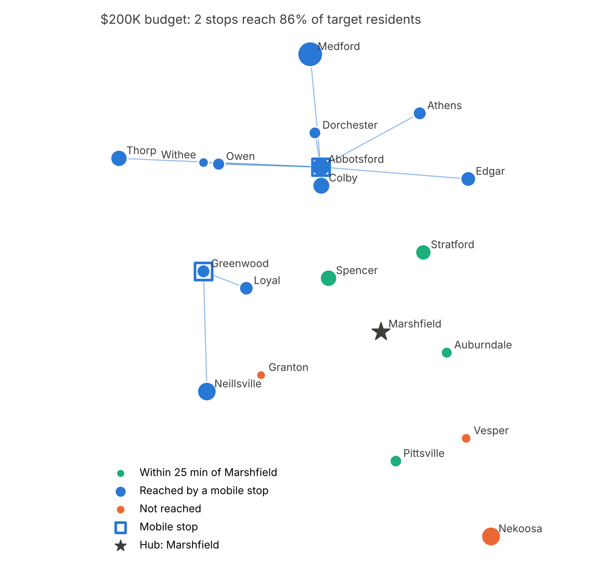
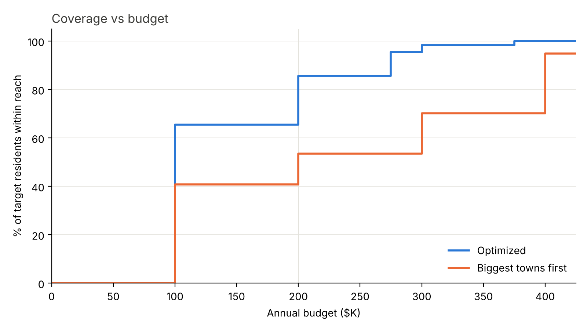

# Mobile Clinic Siting in Rural Central Wisconsin

A **maximal covering location problem (MCLP)** formulated as a **binary integer program** (a type of mixed-integer program, MIP) and solved in Python with **Pyomo** and the **CBC** solver. The model chooses which towns around Marshfield, Wisconsin should host a weekly preventive-care van stop so that the most residents live within a 25-minute drive of one, on a fixed annual budget.

[](https://colab.research.google.com/github/Aadil6696/rural-mobile-clinic-siting/blob/main/Application_Project_mobile_clinic_siting_Aadil_Ashfaq.ipynb)

> Hypothetical scenario built for coursework (UW–Madison, MS Data Insights and Analytics). Not affiliated with Marshfield Clinic or Sanford Health. Costs are estimates.

## Problem

A preventive-care outreach van (screenings, vaccinations, blood pressure and diabetes checks) serves small towns around Marshfield's main campus. Each weekly stop costs about &#36;84K to &#36;103K a year. A stop reaches every town within 25 minutes of it, so the best stops are often small towns in the middle of a cluster rather than the biggest towns. The model finds the combination of stops that reaches the most residents for a given budget.

## Model

**Sets and parameters**
- $I$: towns (each is both a demand point and a candidate stop)
- $p_i$: population of town $i$
- $c_j$: annual cost of a stop in town $j$ (&#36;K); the Marshfield hub costs 0
- $a_{ij} = 1$ if town $i$ is within 25 minutes of town $j$ (coverage matrix)
- $B$: annual budget

**Decision variables (binary)**
- $y_j = 1$ if a stop opens in town $j$
- $z_i = 1$ if town $i$ is covered

**Objective and constraints**

```math
\begin{aligned}
\max \quad & \sum_{i \in I} p_i \, z_i \\
\text{s.t.} \quad & z_i \le \sum_{j \in I} a_{ij} \, y_j && \forall i \in I \quad \text{(coverage)} \\
& \sum_{j \in I} c_j \, y_j \le B && \text{(budget)} \\
& y_{\text{Marshfield}} = 1 && \text{(existing hub)} \\
& y_j, \, z_i \in \{0, 1\}
\end{aligned}
```

## Data and assumptions

| Input | Value | Source |
|---|---|---|
| Towns and populations | Marshfield + 19 nearby towns | 2020 Census (residents inside town limits) |
| Coordinates | Town internal points | Census TIGERweb 2020 |
| Drive times and road miles | All town pairs, times scaled by 0.79 | OSRM road routing, calibrated to Google Maps |
| Coverage standard | 25 minutes | Assumption: buffer below HRSA's 30-minute access standard |
| Crew wages | NP &#36;63.45, RN &#36;45.93, MA &#36;23.41 per hour | BLS OEWS, Wisconsin medians, May 2025 |
| Benefits, schedule, overhead | +30%; one 8-hour day per week; &#36;10K per stop | Assumptions |
| Mileage | 72.5¢ per mile | IRS 2026 standard rate |
| Site variation | ±10% per stop, seed 42 | Simulated |

Annual cost per stop = 52 × (crew wage × (clinic hours + round-trip drive hours) + round-trip miles × mileage rate) + overhead, then × site variation.

## Results

Marshfield already covers 5 towns within 25 minutes, leaving **23,128 target residents**. The model is compared against a common rule of thumb: open stops in the biggest towns first until the budget runs out.

| Annual budget | Model | Biggest towns first |
|---|---|---|
| &#36;100K | 65% (Abbotsford) | 41% (Medford) |
| **&#36;200K** | **86% (Abbotsford + Greenwood)** | **54% (Medford + Nekoosa)** |
| &#36;300K | 98% | 70% |

The &#36;200K plan is unchanged in 28 of 30 random draws of the site-cost variation.

<p align="center">
  
  
</p>

## Run it

Open the notebook in Colab with the badge above and choose **Runtime → Run all**. The first cell installs Pyomo and CBC through IDAES; the data loads directly from this repo. Every input (budget, coverage minutes, cost assumptions) is in Section 1.

To run locally: `pip install pyomo pandas numpy matplotlib`, put the `cbc` solver on your PATH, then run the notebook.

## Repository

```
├── Application_Project_mobile_clinic_siting_Aadil_Ashfaq.ipynb   # model, results, figures
├── data/
│   ├── marshfield_mobile_clinic_towns.csv   # town, county, pop2020, lat, lon
│   └── town_drive_matrix.csv                # origin, destination, drive_min, road_mi (raw OSRM)
└── figures/
    ├── coverage_map.png
    └── budget_curve.png
```

## Limitations and next steps

- One crew day per week per stop, regardless of how many residents it reaches. Next: a capacitated version with integer crew days sized to expected patients.
- Populations count residents inside town limits only, not surrounding townships. Next: Census block data.
- Existing clinics and hospitals are not modeled.
- Drive-time calibration uses two Google Maps routes.
- Next: weight towns by need, such as uninsured rate (22.5% in Clark County vs 4.5% in Wood County).
